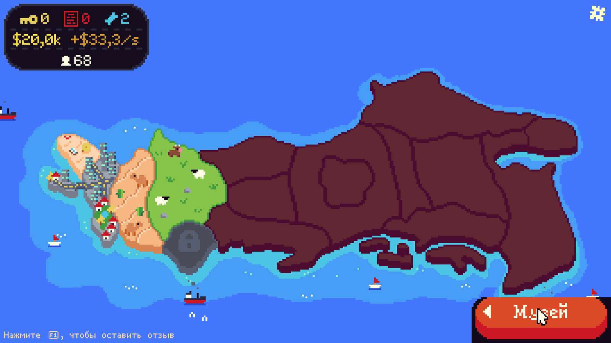
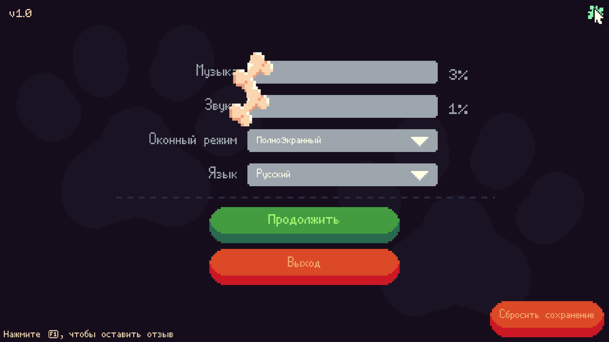
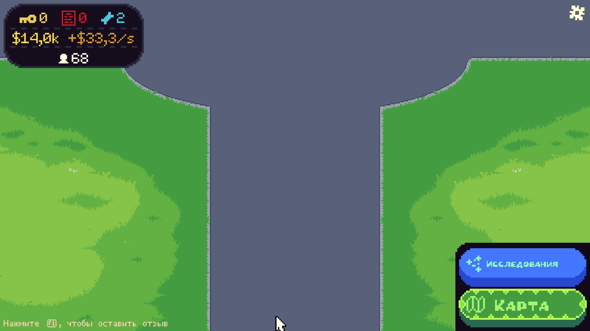
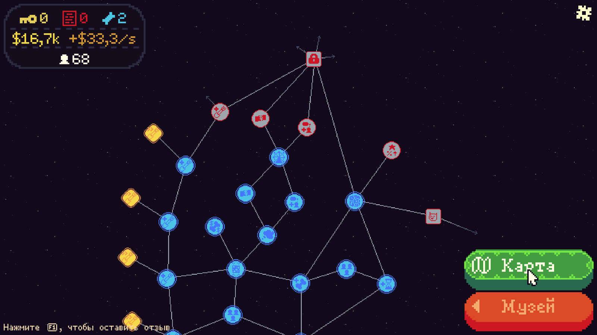
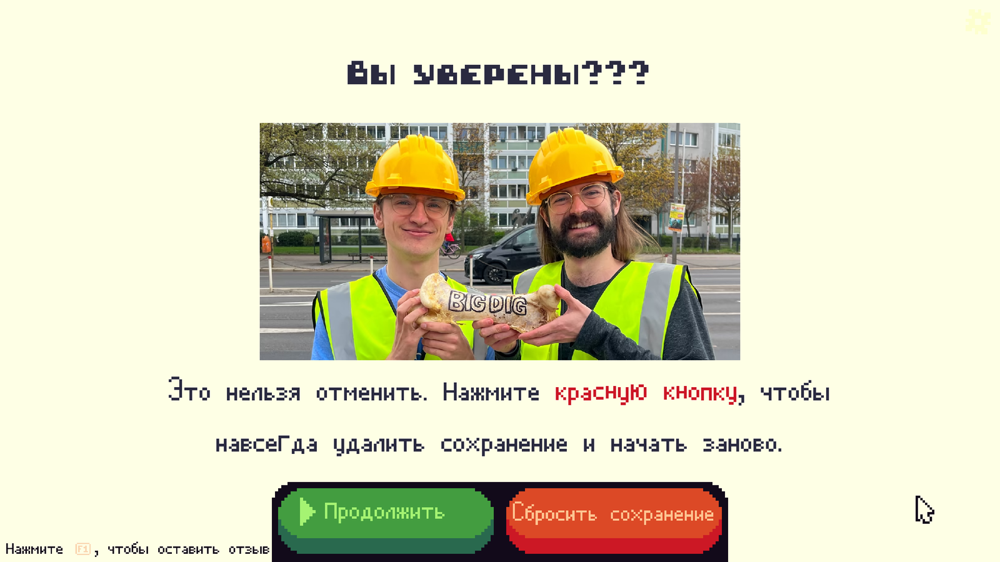

# Big Dig — русский перевод

Полный русификатор для **Big Dig** (Steam, v1.0). Переведены интерфейс, диалоги, карта, артефакты и улучшения — **921 строка**. Ставится одним батником: оригинальные файлы бэкапятся, прогресс сохранения не сбрасывается.



## Что внутри

- 6 таблиц локализации:
  - диалоги — 445 строк;
  - интерфейс — 156;
  - карта — 16;
  - артефакты — 98;
  - описания артефактов — 78;
  - улучшения — 128.
- Русский язык добавлен в меню выбора языка и сразу выбирается в сохранении.
- Шрифты не заменялись: игра рисует кириллицу родными TMP-атласами.
- Rich-text теги, плейсхолдеры и переносы строк сохранены. Проверка — 0 расхождений.

## Скриншоты

| Настройки | Геймплей |
|---|---|
|  |  |

| Техдерево | Диалог |
|---|---|
|  |  |

## Установка

Ничего устанавливать не нужно: используется PowerShell, который уже есть в Windows 10/11.

1. Скачайте репозиторий: **Code → Download ZIP** (или клонируйте).
2. Распакуйте архив целиком. Не запускайте батник прямо из ZIP — Windows распакует его во временную папку без `files`.
3. Закройте Big Dig.
4. Запустите `patcher\Apply-RU.bat`.
5. Если игра не найдена автоматически, укажите папку, в которой лежит `BigDig.exe`.
6. Дождитесь «Готово» и запускайте игру.

Патчер сам:

- делает бэкап в `%USERPROFILE%\Desktop\BigDig-RU-Backup\<дата>`;
- заменяет 16 файлов;
- ставит `languageCode: "ru"` в сохранении.

Если язык не переключился: **Настройки → Язык → Русский**.

### Ручная установка

Если не хотите запускать батник:

1. Скопируйте содержимое `files\BigDig_Data` в `<папка игры>\BigDig_Data` с заменой.
2. В сохранении `...\AppData\LocalLow\BirdGang\BigDig\<SteamID>\<SteamID>_save.json` замените `"languageCode": "en"` на `"languageCode": "ru"` (или выберите русский в настройках).
3. Запустите игру.

Папку `files` нельзя копировать частично: `catalog.bin` и `level0..12` обязательны, иначе игра не увидит русский бандл.

## Что именно меняется

| Файл | Зачем |
|---|---|
| `localization-string-tables-russian(ru)_assets_all.bundle` | Русские строки (6 таблиц) |
| `localization-locales_assets_all.bundle` | Название языка «Русский» |
| `catalog.bin` | CRC = 0 и новые размеры двух бандлов |
| `BigDig_Data\level0..12` | `ru` убран из `disabledLocales`, язык появляется в списке |
| сохранение | `languageCode: "ru"` |

Подробности — в [docs/TECHNICAL.md](docs/TECHNICAL.md).

## Откат

Запустите `patcher\Restore-RU.bat`. Скрипт возьмёт последний бэкап из `Desktop\BigDig-RU-Backup` и вернёт оригинальные файлы и сохранение.

Если бэкап уже удалён — в Steam: **Свойства → Установленные файлы → Проверить целостность файлов**. Это вернёт оригиналы, но прогресс сохранения не тронет.

## После обновления игры или проверки целостности

Steam перезапишет пропатченные файлы. Просто запустите `Apply-RU.bat` снова. Если игра обновилась и патч перестал работать — скорее всего, изменились бандлы или `catalog.bin`; напишите issue с версией игры.

## Структура

```
BigDig-RU/
├─ patcher/          # установка и откат, без Python и зависимостей
├─ files/            # готовые файлы для замены
├─ translation/      # исходники перевода: 6 JSON + глоссарий
├─ screenshots/      # скриншоты
├─ docs/             # техническое описание
├─ tools/            # пересборка бандлов (Python + UnityPy)
├─ SHA256SUMS.txt    # контрольные суммы файлов
├─ CHANGELOG.md
├─ NOTICE.md
└─ LICENSE
```

## Перевод

Глоссарий и правила — в [translation/TRANSLATION_BRIEF.md](translation/TRANSLATION_BRIEF.md). Коротко:

- Мэр Пёс, Мэр Лягушка, Пумба, Догополис, Миддлсвилль;
- «Сделаем это!», «Пожертвование», «Очки исследований»;
- Big Dig, Bird Corp, Feed for Speed, Omelet You Cook — латиницей.

Переводы лежат в `translation/ru/*.json` в формате `[{ "id": ..., "ru": "..." }]`. Если нашли опечатку или обрезанную строку — пришлите скриншот и название экрана; поправлю.

## Что проверено

- Главное меню, настройки, HUD, техдерево, карта и диалоговое окно сброса сохранения — русский текст, кириллица без квадратов.
- Все 921 строка на месте; теги и плейсхолдеры не потеряны.
- Полный сюжет от начала до конца не прогонялся. Если где-то встретилась кривая фраза — это чинится точечно.

## Права

Big Dig и все игровые ассеты принадлежат BirdGang. Это фанатский перевод для личного использования с легально купленной копией игры. Проект не связан с разработчиками. Код патчера — MIT; тексты перевода и файлы игры — не для коммерческого распространения. Подробнее — [NOTICE.md](NOTICE.md).

## Changelog

См. [CHANGELOG.md](CHANGELOG.md).

## Поддержка
https://boosty.to/ga4ignida
